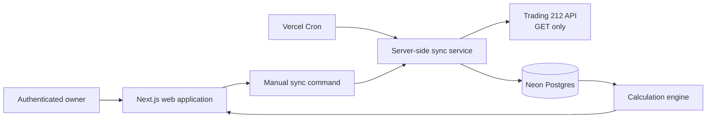

# Architecture and Data Model

## Runtime architecture

Next.js runs on Vercel Node.js Functions. GitHub is the private source repository and deployment trigger, not the application runtime. Neon Postgres is the durable system of record. UI routes query calculated views and never call Trading 212 directly.

## Data-layer boundaries

1. **Provider adapter:** makes allowlisted Trading 212 GET calls and returns validated provider payloads.
2. **Ingestion:** creates idempotent raw source records and import metadata.
3. **Normalization:** maps provider events to stable domain types; unresolved values remain `unknown`.
4. **Accounting:** creates lots, disposal allocations, classifications, reconciliations, and calculation results.
5. **Read models:** creates efficient dashboard/history/asset queries without changing evidence.
6. **Presentation:** renders metrics with coverage, methodology, and source status.

No layer may skip directly from browser input to a calculation or provider call.

## Logical schema

| Table | Responsibility | Key invariants |
|---|---|---|
| `accounts` | Broker account and reporting configuration | unique provider + external account ID + environment |
| `instruments` | Stable instrument identity and metadata | provider ticker retained; ISIN/exchange when known |
| `import_sources` | CSV/API report provenance and parser version | hash and source range are immutable |
| `raw_events` | Original normalized-independent payload | unique source + external ID or canonical hash |
| `cash_transactions` | Provider cash movements | amount uses `numeric`; type may be `unknown` |
| `orders` | Historical order/execution facts | external ID stored as text, never JS number |
| `dividends` | Gross, withheld, net income records | values cannot be silently merged |
| `account_snapshots` | Account NAV, cash, totals per sync | append-only; timestamped |
| `position_snapshots` | Broker position value/quantity per sync | account + instrument + snapshot unique |
| `lots` | Opening cost-basis records | remaining quantity is never negative |
| `lot_disposals` | FIFO sale-to-lot assignments | allocation quantity <= open lot quantity |
| `classifications` | Versioned rule or manual business mapping | manual override is attributed/reversible |
| `sync_runs` | Execution audit and counters | one terminal status per run |
| `sync_checkpoints` | Safe incremental progress | advances only after committed work |
| `sync_leases` | Prevent concurrent account syncs | expiry and owner required |
| `reconciliation_issues` | Visible data discrepancies | never auto-dismissed without evidence |
| `manual_adjustments` | Auditable source correction | append-only, linked to reason/evidence |
| `projection_scenarios` | User-owned hypothetical inputs/results | never joins historical metric tables |

Use `numeric` for amounts and quantities, `text` for opaque external IDs, `timestamptz` for source instants, `jsonb` for raw payload, and ISO currency codes. Store original, broker-account, and presentation values separately when conversions exist.

## Lifecycle of a source event

1. Receive API page or parsed CSV row.
2. Validate schema and retain exact source payload/hash.
3. Upsert the raw event with a stable provider identity.
4. Normalize into a domain record, preserving `unknown` if a field cannot be mapped.
5. Rebuild only affected accounting records using the active policy version.
6. Reconcile positions, cash, and NAV against the latest snapshot.
7. Publish read models with coverage and issue flags.

## Database security

The browser never holds `DATABASE_URL`. The application role may perform only runtime DML; a separate migration role owns DDL. Use the Neon pooled SSL URL for server functions. PgBouncer transaction pooling does not support session-state patterns such as `LISTEN`, session advisory locks, or persistent temporary tables. [Neon pooling guidance](https://neon.com/docs/connect/connection-pooling).

